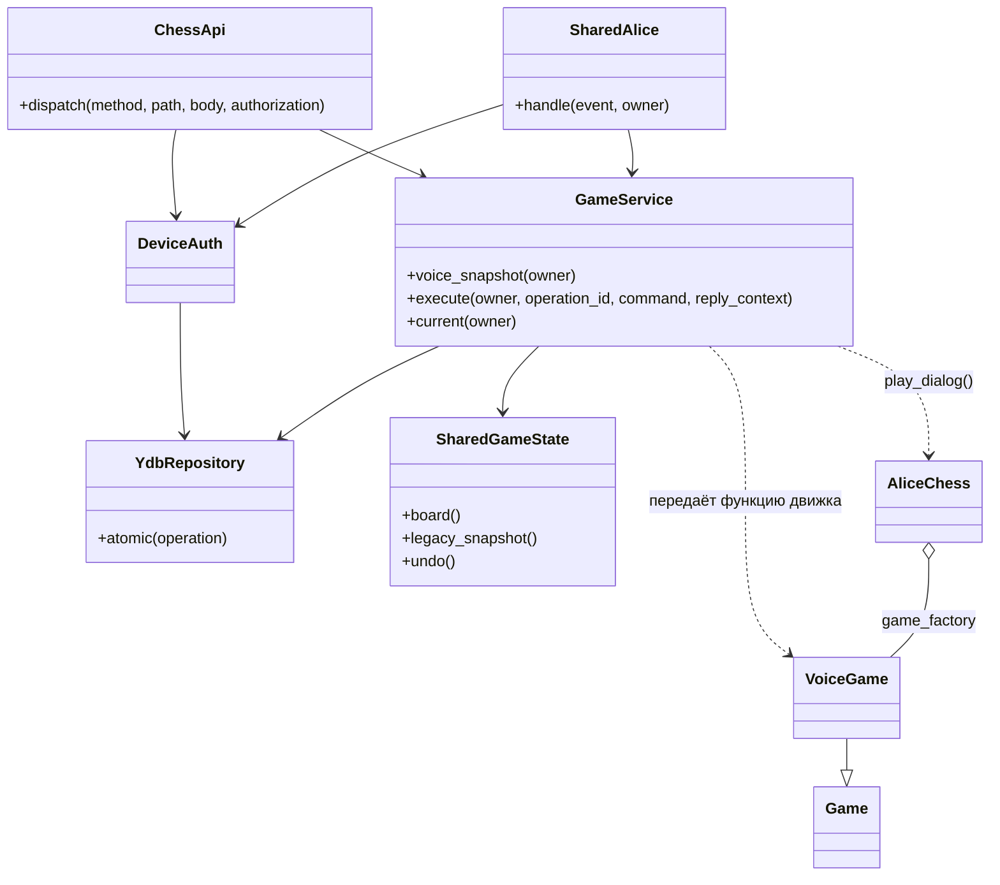

# Классы по контурам

## Прод

```mermaid
classDiagram
    class AliceChess {
        +handle_request(request)
        +get_game_state()
        +get_session_state()
    }
    class Game {
        +user_move(move_san)
        +comp_move()
        +undo_move()
        +serialize_state()
        +quit()
    }
    class BaseHandler {
        <<abstract>>
        +safe_handle()
        +handle()
    }
    class GameStateV2
    class Board
    class SimpleEngine
    class TextPreparer
    class Speaker
    class MoveExtractor
    AliceChess o-- Game
    AliceChess --> BaseHandler : выбирает по SkillState
    BaseHandler --> Game
    BaseHandler --> TextPreparer
    BaseHandler --> Speaker
    TextPreparer --> Speaker
    Game --> Board
    Game --> SimpleEngine : локальный UCI
    Game ..> GameStateV2 : сериализация
    BaseHandler ..> MoveExtractor : обработка хода и цвета
```

`SimpleEngine` и `Board` предоставлены python-chess. Точка входа
`alice_serverless.handler` создаёт `AliceChess` в контекстном менеджере.

## Тестовый общий режим

`SharedAlice` исполняется в функции тестового навыка, `ChessApi` — в функции API.
Обе функции используют свои экземпляры сервиса и один репозиторий YDB.
Штатные обработчики диалога из продовой схемы используются через `VoiceGame`.
