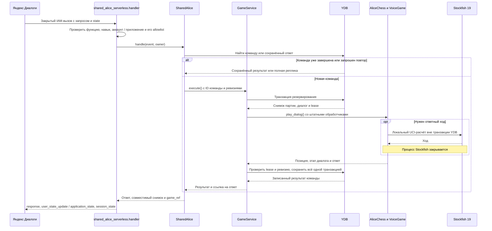

# Обработка голосового запроса

## Прод

```mermaid
sequenceDiagram
    participant D as Яндекс Диалоги
    participant F as alice_serverless.handler
    participant A as AliceChess
    participant G as Game
    participant E as Stockfish 14.1
    D->>F: Запрос, state.user / state.application и state.session
    Note over F,A: Аккаунт — user; аноним — application
    F->>A: handle_request(event)
    alt Дубликат message_id
        A-->>F: previous_response из session_state
    else Новый запрос
        A->>G: Восстановить GameState V1/V2
        A->>A: Специальный интент или обработчик SkillState
        alt YANDEX.REPEAT
            A-->>F: previous_response из session_state
        else Обычная команда
            opt Нужен ответный ход
                A->>G: comp_move()
                G->>E: Ленивый запуск UCI и расчёт
                E-->>G: Ход
            end
            A-->>F: Ответ и обновлённые состояния
        end
    end
    F->>G: Game.quit() при выходе из with AliceChess
    Note over G,E: Созданный процесс Stockfish закрывается
    F-->>D: response, user_state_update / application_state, session_state
    D->>D: Сохранить позицию и контекст сессии
```

## Тестовый навык

Схема показывает обычную команду разрешённого аккаунта. Входной адаптер также
может вернуть короткую сохранённую реплику из сессии или передать аккаунт вне
пилота без `game_ref` продовому обработчику.



Ходы приложения проходят через Gateway и `ChessApi` в собственный экземпляр
того же `GameService`. Конфликтующие операции проверяются по общей ревизии в YDB.
Резервирование и завершение команды описаны в [архитектуре тестового контура](../architecture.md#тест).
