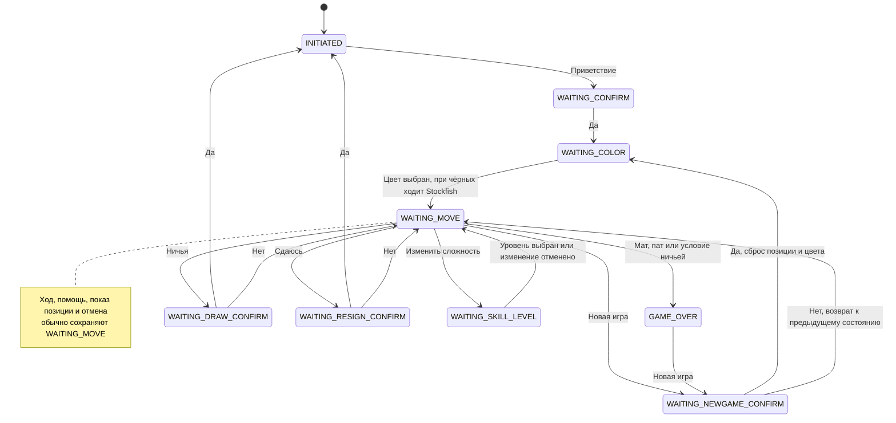

# Состояния голосового диалога

Прод и разрешённый аккаунт тестового навыка используют одни обработчики `SkillState`.
Схема показывает основной сценарий. Специальные интенты обрабатываются до выбора
хендлера текущего состояния. При отказе от подтверждения или смены сложности
восстанавливается `prev_skill_state`.

| Данные автомата | Прод | Тестовый общий режим |
| --- | --- | --- |
| Текущий и предыдущий этап | `state.user.game_state` | YDB, `players.dialog` |
| Возврат в новой сессии | Снимок из Диалогов | Снимок диалога, согласованный с ревизией партии |
| Подтверждение после изменения позиции | Контекст одного навыка | Проверка `game_ref` и `dialog_revision` |

Превращение пешки разбирается в ходе обработки хода. Реальные значения состояний
перечислены в [skill_state.py](../../skill_state.py).
