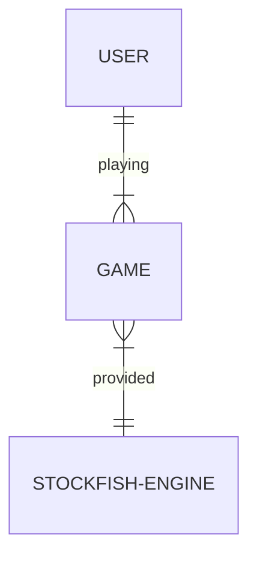
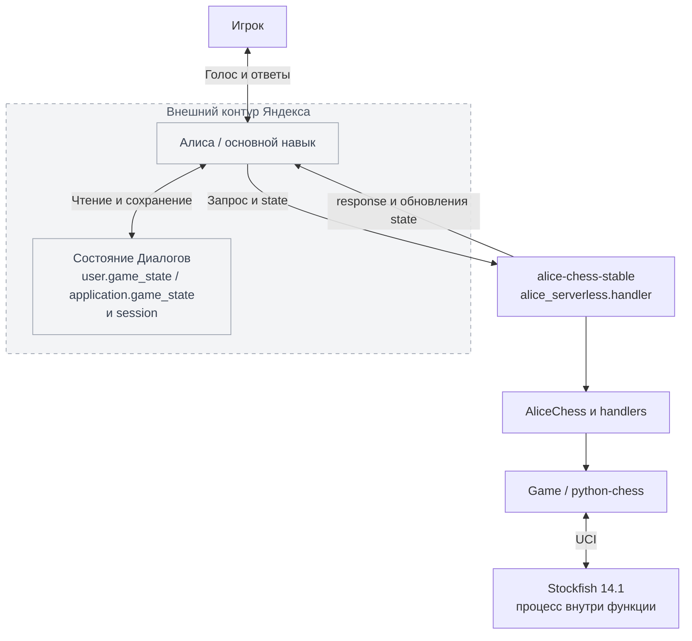
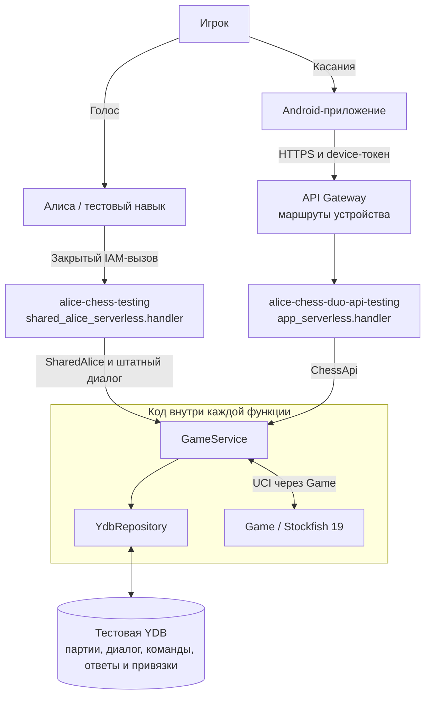
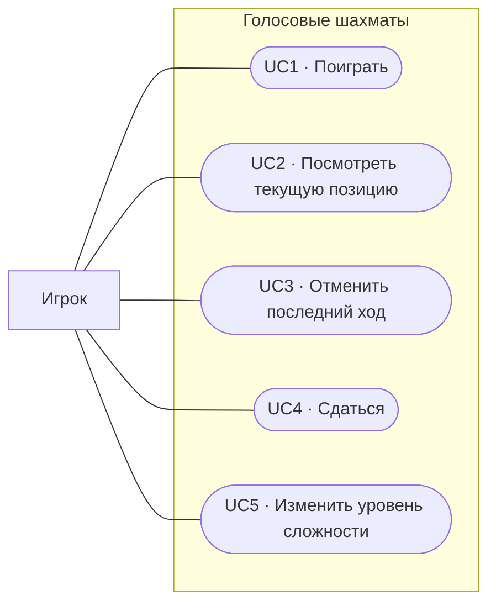

# Оглавление
- [Глоссарий](#glossary)
- [Проблема](#problem)
- [Решение](#solution)
- [Стейкхолдеры](#stakeholders)
- [Сущности предметной области](#er)
- [Бизнес-требования](#brq)
- [Контекстная диаграмма](#context_diagram)
- [Сценарии](#usecases)
- [Функциональные и нефункциональные требования](#fr_nfr)
- [Архитектура](#architecture)
- [API](#api)
- [Деплой](#deployment)
- [Базовые тесты](#tests)
- [Ссылки](#links)

----

# <a name="glossary"></a> Глоссарий
* **Алиса** - Виртуальный голосовой помощник, созданный компанией Яндекс.
Распознаёт естественную речь, имитирует живой диалог, даёт ответы на вопросы пользователя и, благодаря запрограммированным навыкам, решает прикладные задачи
* **Навык** (син. Диалог) - сценарии, которые разработали компании и пользователи, не имеющие отношения к создателям Алисы.
* **Бессерверная функция** - сервис Яндекс Облака для запуска кода без управления серверами
* **Stockfish** - открытый шахматный движок, используемый для расчета ходов

# <a name="problem"></a> Проблема
Алиса (помощник Яндекса) не поддерживает возможность играть голосом в шахматы. Голосовые шахматы реализованы у конкурентов, например, Алексы.
При этом, с технической точки зрения реализация не должна быть сложной.
Игра в шахматы может быть монетизируемой, но пока концепции монетизации не разработано.

# <a name="solution"></a> Решение
Реализовать навык для Алисы, с помощью которого можно играть в шахматы голосом.
Навык должен быть доступен как на устройствах с экраном, так и без.
Использовать готовый шахматный движок Stockfish. Версия определяется контуром поставки.
Поддержать один язык: русский.

# <a name="stakeholders"></a> Стейкхолдеры
Основные классы стейкхолдеров и их интересы:
- Пользователь - кайфануть от игры
- Разработчик - кайфануть от рабочего кода
- Продакт-менеджер - кайфануть от наличия навыка

# <a name="er"></a> Сущности предметной области



# <a name="brq"></a> Бизнес-требования и ограничения
## User Stories
### US-1
Я, как пользователь, хочу сыграть с Алисой в шахматы голосом в сокращенной шахматной нотации по современным правилам шахмат ФИДЕ

### US-2
Я, как пользователь, хочу сыграть с Алисой в шахматы голосом без экрана,
чтобы получить удовольствие от игры и развить свои навыки визуализации ситуации на шахматной доске в уме.

### US-3
Я, как пользователь, хочу сыграть с Алисой в шахматы голосом с экраном,
чтобы не затруднять мозг визуалиацией ситуации на шахматной доске. Команды отдаю голосом.

### US-4
Я, как создатель навыка, хочу, чтобы навык одновременно выдерживал до 100 партий,
чтобы обеспечить хороший пользовательский опыт у достаточного количества игроков

## Ограничения

1. Целевое время ответа навыка — до 3 секунд.
2. Runtime функций — Python 3.14.
3. Ресурсы и таймауты функций задаются отдельно для прода и теста. Текущие значения приведены в [описании контуров](architecture.md#контуры).

# <a name="context_diagram"></a> Контекстная диаграмма

## Прод

Игрок обращается к основному навыку через Алису. Платформа Диалогов передаёт позицию
и этап разговора в каждом запросе и сохраняет обновления из ответа.
Серый пунктирный контур объединяет компоненты на стороне платформы Яндекса.



## Тест

Закрытый навык «Голосовые шахматы» и Android-приложение обращаются к одной партии в YDB.
Общий голосовой режим включён для разрешённого тестового аккаунта. Код сервиса партий
и локальный Stockfish исполняются внутри каждой из двух функций.



Системная доставка речи в открытый APK через YaOS AppFunctions проверяется отдельно
на Дуо Макс. Проверки общей партии через Диалоги и касания в эмуляторе описаны
в [документе о голосовом режиме](shared-voice-dialog.md).

# <a name="usecases"></a> Сценарии
## Диаграмма юзкейсов



## UC1: Поиграть
### Предусловия
- Навык запущен
- Пользователь выбрал цвет фигур

### Постусловия
- Игра завершена (мат, пат, ничья или сдача)

### Основной сценарий
1. Пользователь объявляет ход
2. Система проверяет корректность хода
3. Система делает свой ход
4. Система объявляет результат хода
5. Повторять шаги 1-4 до окончания игры

### Альтернативные сценарии
1. Невозможный ход
   - Система сообщает о невозможности хода
   - Пользователь делает другой ход
2. Ход с двумя стартовыми вариантами
   - Система запрашивает уточнение
   - Пользователь уточняет ход
3. Взятие фигуры
   - Система подтверждает взятие
4. Превращение пешки
   - Система запрашивает фигуру для превращения
   - Пользователь выбирает фигуру
5. Шах
   - Система объявляет шах
6. Мат
   - Система объявляет мат
   - Игра завершается

## UC2: Посмотреть текущую позицию на доске
### Предусловия
- Игра идет

### Основной сценарий
1. Пользователь запрашивает позицию
2. Система объявляет текущую позицию

## UC3: Отменить последний ход
### Предусловия
- Игра идет
- Сделан хотя бы один ход

### Основной сценарий
1. Пользователь запрашивает отмену хода
2. Система отменяет последний ход
3. Система объявляет новую позицию

## UC4: Сдаться
### Предусловия
- Игра идет

### Основной сценарий
1. Пользователь объявляет о сдаче
2. Система подтверждает сдачу
3. Игра завершается

## UC5: Изменить уровень сложности
### Предусловия
- Игра идет

### Основной сценарий
1. Пользователь запрашивает изменение уровня
2. Система запрашивает новый уровень (1-20)
3. Пользователь указывает уровень
4. Система подтверждает изменение

# <a name="fr_nfr"></a> Функциональные и нефункциональные требования
## Функциональные требования

- FR-1: Преобразовывать входящий от Алисы текст в команды, понятные движку
- FR-2: Поддерживать все типы ходов (обычный, взятие, рокировка, превращение)
- FR-3: Проверять корректность ходов по правилам шахмат
- FR-4: Определять окончание игры (мат, пат, ничья)
- FR-5: Поддерживать отмену последнего хода
- FR-6: Поддерживать сдачу
- FR-7: Поддерживать изменение уровня сложности

## Нефункциональные требования
NFR-1: Юзабилити
- Понятные сообщения об ошибках
- Подсказки при неверных ходах
- Возможность получить помощь в любой момент

NFR-2: Производительность
- Время ответа < 3 секунд
- Поддержка до 100 одновременных игр

NFR-3: Надежность
- Сохранение состояния игры
- Корректная обработка ошибок
- Логирование действий

# <a name="architecture"></a> Архитектура

## Прод

Основной навык использует функцию `alice-chess-stable` с точкой входа
`alice_serverless.handler`. `AliceChess` восстанавливает `GameStateV2` из
`state.user.game_state` для аккаунта или `state.application.game_state` для анонима,
выбирает обработчик по `SkillState` и возвращает обновлённую позицию через
`user_state_update.game_state` или `application_state.game_state` соответственно.

Повторная доставка проверяется по `session_state.last_message_id`.
Полный предыдущий ответ хранится в `session_state.previous_response` и используется
для дубликата и команды «Повтори». Ход рассчитывает локальный Stockfish 14.1 через UCI.

## Тест

Закрытый навык «Голосовые шахматы» использует `alice-chess-testing` с точкой входа
`shared_alice_serverless.handler`. Для разрешённого аккаунта `SharedAlice` загружает
партию из YDB. Голосовой диалог исполняют те же `AliceChess` и `handlers/`
через адаптер `shared_chess/dialog.py`.

Android-приложение обращается через HTTPS Gateway к отдельной функции
`alice-chess-duo-api-testing` с обработчиком `app_serverless.handler`.
Обе функции используют `GameService` и `YdbRepository`. Stockfish 19 запускается
локально в функции, которая обрабатывает команду.

YDB хранит партию, этап разговора, журнал команд и полные ответы. В состоянии Диалогов
остаются совместимый снимок партии, ссылка `game_ref` и ссылка на ответ либо короткий
ответ об ошибке. Команда резервируется транзакцией, расчёт выполняется вне транзакции,
затем позиция, диалог и ответ сохраняются атомарно. Ревизии партии и диалога защищают
от конфликтующих ходов и устаревших подтверждений.

Для аккаунтов вне пилота без `game_ref` тестовая функция использует обработчик
`alice_serverless.handler`. Для уже перенесённой партии ошибка доступа или YDB
возвращает сообщение о недоступности с сохранением входного состояния.
Анонимное приложение получает отдельный ключ YDB и требует отдельного допуска в пилот.
Без допуска оно использует `application_state`. Автоматического переноса между
аккаунтом и анонимным приложением нет; [контракт анонимной игры](anonymous-games.md).

## Документы и схемы

- [Сравнение контуров, компоненты и состояние](architecture.md).
- [Контекстные схемы прода и теста](#context_diagram).
- [Последовательность обработки запроса в каждом контуре](diagrams/sd_request_processing.md).
- [Общий автомат голосового диалога](diagrams/state_diagram.md).
- [Классы прода и тестового режима](diagrams/class_diagram.md).
- [Голосовой диалог с хранением в YDB и его проверки](shared-voice-dialog.md).

# <a name="api"></a> API
## Форматы данных
### Входящий запрос
```json
{
    "version": "1.0",
    "session": {
        "session_id": "string",
        "user_id": "string"
    },
    "request": {
        "command": "string",
        "original_utterance": "string",
        "type": "string"
    }
}
```

### Исходящий ответ
```json
{
    "version": "1.0",
    "session": {
        "session_id": "string",
        "user_id": "string"
    },
    "response": {
        "text": "string",
        "end_session": false
    }
}
```

# <a name="deployment"></a> Деплой
Правила запуска GitHub Actions, конфигурация трёх функций и порядок отката приведены в [инструкции по поставке](deployment.md).

# <a name="tests"></a> Базовые тесты
1. Проверка корректности ходов
2. Проверка обработки ошибок
3. Проверка окончания игры
4. Проверка производительности
5. Проверка интеграции с Алисой

# <a name="links"></a> Ссылки
1. [Правила шахмат ФИДЕ](https://handbook.fide.com/chapter/E012018)
2. [Шахматые нотации](https://ru.wikipedia.org/wiki/Шахматная_нотация)
3. [Навык Шахматы вслепую на платформе диалогов Яндекса](https://dialogs.yandex.ru/developer/skills/2310188c-c404-4342-8bbe-d397f25d9de2/)
4. [Документация Яндекс Облака](https://cloud.yandex.ru/docs/functions/)
5. [Документация Stockfish](https://stockfishchess.org/documentation/)
6. [Документация Яндекс Диалогов](https://yandex.ru/dev/dialogs/alice/doc/)
